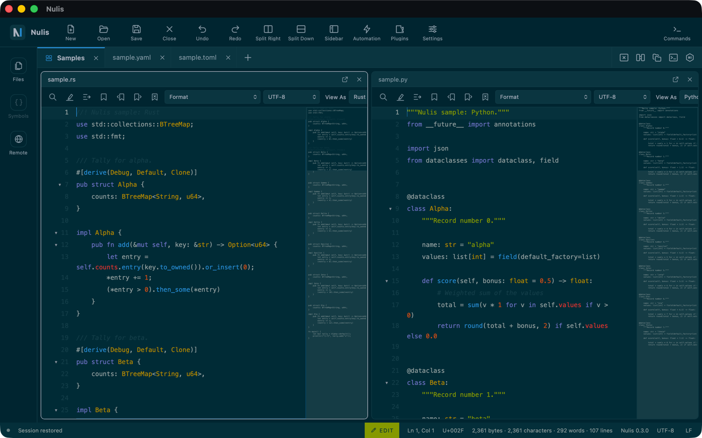
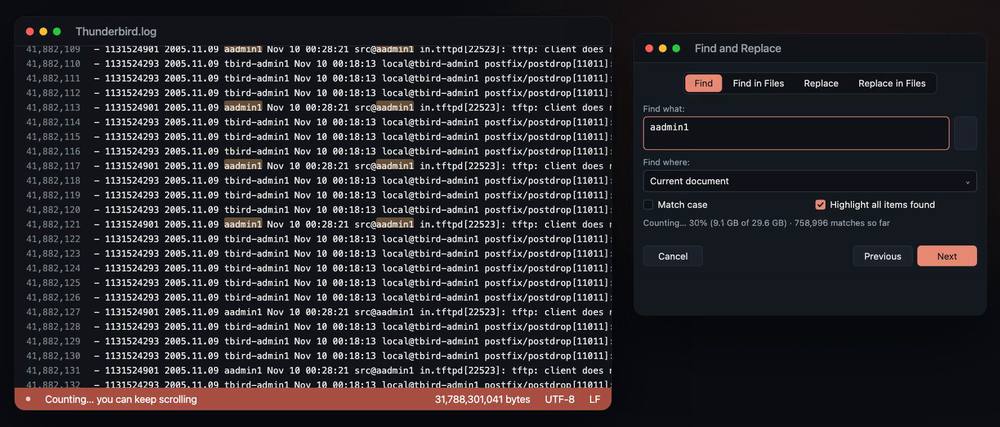
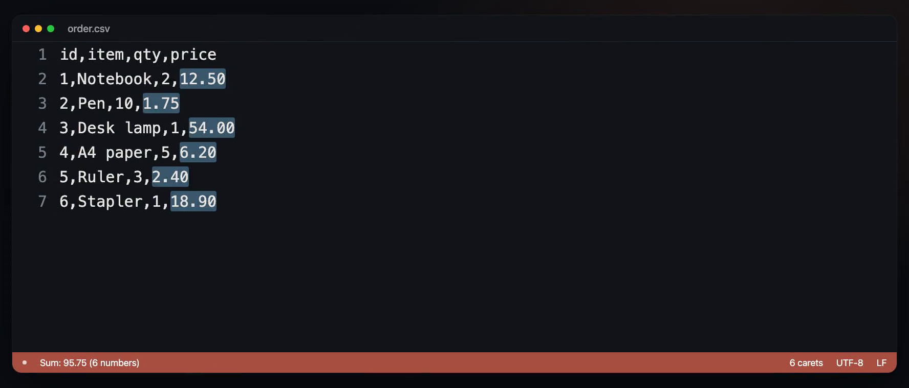
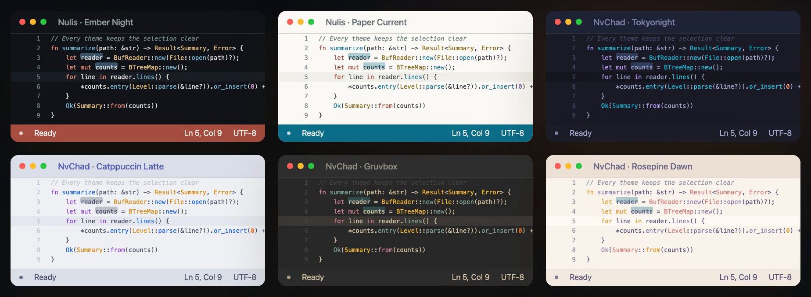

<p align="center"></p>

# Nulis

[](https://github.com/suhermanme/nulis/actions/workflows/ci.yml)

Nulis is a desktop editor for text, source code, hexadecimal data, and files larger than memory. It runs on macOS, Windows, and Linux.

*Nulis* is a Javanese word that means "writing" or "to write". The logo draws that idea as the letter N, whose last stroke is the text caret where writing happens.

Nulis is free software under the [GNU General Public License, version 3 or later](LICENSE).

**[Download the latest release](https://github.com/suhermanme/nulis/releases/latest)** for macOS, Windows, and Linux.

**A 2-minute tour** (silent, with captions):

https://github.com/user-attachments/assets/834bbc37-10c6-45fe-882a-8b77acf4d133



- [Installing](#installing)
- [A quick tour](#a-quick-tour)
- [What Nulis does](#what-nulis-does)
- [Project status](#project-status)
- [Using Nulis](#using-nulis)
- [Architecture](#architecture)
- [Repository layout](#repository-layout)
- [Building from source](#building-from-source)
- [Testing and quality checks](#testing-and-quality-checks)
- [Where Nulis stores data](#where-nulis-stores-data)
- [Extending Nulis](#extending-nulis)
- [Security model](#security-model)
- [Documentation](#documentation)
- [Contributing](#contributing)
- [License](#license)

## Installing

Download the file for your system from the [latest release](https://github.com/suhermanme/nulis/releases/latest), or on macOS use [Homebrew](https://brew.sh):

```sh
brew tap suhermanme/nulis https://github.com/suhermanme/nulis
brew trust suhermanme/nulis   # only on Homebrew versions that gate non-official taps
brew install --cask nulis
```

| System | Download | First launch |
| --- | --- | --- |
| macOS (Apple silicon and Intel) | `Nulis_<version>_universal.dmg` | Not notarized: allow it once in **System Settings ▸ Privacy & Security ▸ Open Anyway**. |
| Windows | `Nulis_<version>_x64-setup.exe` | Not code-signed: in SmartScreen, **More info ▸ Run anyway**. |
| Linux | `.deb` (`sudo apt install ./…`) or `.rpm` (`sudo dnf install ./…`) | Nothing to allow. |

[docs/INSTALL.md](docs/INSTALL.md) has the steps in full, Homebrew troubleshooting, and how to check the downloads against `SHA256SUMS.txt`.

## A quick tour

**Files larger than memory.** Nulis reads only what is on screen, so a 31 GB log opens at once. Count All runs in the background with progress and Cancel, and you can keep scrolling while it counts.



**Multiple carets and column tools.** Alt-click (Option-click on macOS) adds a caret on each line you need. With numbers selected in a column, the status bar adds them up.



**99 themes, light and dark.** Nulis's own Ember Night and Paper Current, plus the NvChad collection. The theme you apply recolors the whole application, and keeps the selection easy to see. Duplicate any theme to get an editable copy of it, pick its colors in the panel with a live preview, and Nulis keeps it as your own theme.



## What Nulis does

### Editing

- **Files of any size.** A file is never loaded whole. Nulis reads only what is on screen, so a 10 GiB file opens as fast as a small one, and editing in the middle of it is as fast as at the end.
- **Safe saving.** Save writes a temporary file beside the original, syncs it, verifies it, checks that nobody else changed the original, and replaces the original in one step. A failed save leaves the original untouched.
- **Undo and redo** within a memory budget. Undoing back to the saved content clears the unsaved mark.
- **Multiple carets** (Alt-click) and **column (block) editing** (Alt-Shift-drag or column mode), including typing and pasting across rows.
- **Precise pointer editing**: double-click selects a word, triple-click a line, and a selection can be dragged to move or copy it as one undo step.
- **Insert and overwrite modes**, case and whitespace transforms, word wrap, bookmarks, and code folding.
- **Edit and Read-Only modes** per document, switched with one click or Ctrl/⌘ Shift L and shown unmistakably in the status bar, toolbar, and tab. Read-only is enforced in the core, so nothing can change a protected document.
- **A status bar** with the mode, the caret's line and column, and the document's size in bytes and in characters.
- **Line change indicators** in the gutter: red for unsaved changes, green for changes saved in this session, a notch where lines were deleted.
- **Encodings**: UTF-8 and Windows-1252, switchable per document without rewriting bytes that were not edited.
- **Crash recovery**: unsaved edits of local and untitled documents are checkpointed and offered for recovery at the next start.

### Finding things

- **Find and replace** in the current file, with match case, whole words, regular expressions that can never hang (even on huge files), capture groups in the replacement (`$1`, `${name}`), search within columns, multi-line matches, and Replace All as one undo step.
- **Find in files** across a folder, with fixed limits on files and results.
- **Go to line**, a **symbols list** per document, bracket matching, and a document map.

### Languages

- **Syntax highlighting, folding, and symbols** for 43 languages: AppleScript, Bash, Batch, C, C++, C#, CSS, CSV, Dockerfile, Go, HTML, Ignore File, INI, Java, JavaScript, JSON, JSON with Comments, Kotlin, Lua, Makefile, Markdown, MySQL / MariaDB, Objective-C / Objective-C++, Oracle PL/SQL, Perl, PHP, PowerShell, Property List, Python, Ruby, Rust, SQL, Swift, TOML, TSX, TSV, TypeScript, VBScript / ASP, Visual Basic, XML, XSL, YAML, and Zig. A sample of each is in [`Samples/`](Samples).
- **Detection** from the file name and extension, and from the content (`#!` line, XML declaration, `<?php`, HTML doctype) when the name says nothing. A **View As** control overrides it.
- **Automatic indentation.** Enter follows the language's blocks after `{`, `:`, an opening tag, a YAML key, or a keyword such as `def` or `then`; closing brackets, tags, and `end`/`fi` move into place. Tab and Backspace follow the file's own indentation, and Settings can switch the rules off per language.
- **Suggestions while you type** from the document's words, the language's keywords and types, and snippets, with placeholders visited with Tab. Ctrl+Space (Option+Esc on macOS) asks anywhere.
- **Optional language servers** such as `rust-analyzer` and `clangd` show their problems in the gutter, under the text, and in the **Problems** panel. Nothing runs until you configure and approve the exact command.
- **Your own file associations** in `settings.json`, with **Settings ▸ Languages** listing any conflict between languages or plugins.

### Tools

- **JSON, XML, YAML, and plist tools**: validate (the caret moves to the first problem, and repeated keys are caught), beautify, and JSON minify. YAML Beautify asks before it would drop comments. The tools are offered only while such a document is focused.
- **Hexadecimal editor** with synchronized hex and text columns, for files of any size.
- **Compare and merge** two documents (text by line, binary by byte) and **compare folders**.
- **Markdown preview** with GitHub-style syntax and local images.
- **Print and Export to PDF**, with a Page Setup dialog (paper, margins, font size, colors, line numbers, header and footer) and a live preview. Printed pages and the PDF match line for line. Large files export in the background with progress and Cancel; a selection or a hex dump can be exported too, and Markdown in View mode prints formatted.
- **Integrated terminal** running the platform's default shell.

### Workbench

- **Tabs and workspaces.** Drag a tab into the editor area to group files into one named workspace tab with split panes. Panes can be resized, rearranged, popped back out, and are restored with the session.
- **File View** with three tabs: open files, the whole computer (home, common folders, mounted volumes), and the opened folder.
- **Command palette** for every command, icon toolbars with captions and tooltips, and native menus.
- **Sessions**: open files, layout, folder, and side bar are restored at startup.
- **Opening from the system**: on macOS, Nulis appears in Finder's **Open With** menu for text, code, and data files (without becoming the default app), and accepts files dropped on its Dock icon. Files arrive in the running window.

### Customization and extension

- **Settings window** with sections for the editor, appearance, languages, keybindings, menus and toolbar, workspaces, and extensions.
- **99 built-in color themes**, with Nulis's own Ember Night and Paper Current first, plus user themes: install a theme file, duplicate any theme into your own editable copy, and pick its colors with a live preview. In every theme the selection, secondary text, and toolbar icons are kept clearly visible, and the panel names any color Nulis will paint stronger than you picked it.
- **Configurable** shortcuts, File menu, and main toolbar.
- **Macros** (record and replay) and **scripts** that run only after explicit approval of the commands they use.
- **Plugins** written in JavaScript, each running in an isolated worker process and approved by content digest, or **declarative language plugins** that add highlighting, indentation, completion, and snippets as data and run no code. Every approved plugin and every feature family it contributes can be switched off separately.

## Project status

The current release is Nulis 0.5.3, and Nulis is under active development. The features above are implemented and covered by automated tests. On every push, CI builds the macOS, Windows, and Linux packages, installs each one as a user would, and starts it. Tagged releases are built, checked, and published the same way. [docs/PLATFORM_MATRIX.md](docs/PLATFORM_MATRIX.md) records what has been checked on each system.

Known limits:

- Nulis is developed on macOS. On Windows only some features have been checked by hand so far, and on Linux none have; CI covers the rest.
- The macOS app is ad-hoc signed but not notarized, and the Windows installer is not code-signed, so both systems ask once before the first launch (see [Installing](#installing)).
- Encoding support is limited to UTF-8 and Windows-1252, without automatic detection.
- XML validation checks well-formedness only, not DTDs or schemas.
- Testing with screen readers (VoiceOver, NVDA, Orca) has not been done yet.

[docs/FEATURE_PARITY.md](docs/FEATURE_PARITY.md) tracks each capability in detail, and [docs/ROADMAP.md](docs/ROADMAP.md) lists what is planned.

## Using Nulis

The complete user guide is [docs/USER_GUIDE.md](docs/USER_GUIDE.md). The same guide is built into the application under **Help ▸ Nulis Help** (F1), which opens a separate Help window with one section per chapter and a search field. **Help ▸ About Nulis** shows the version, the origin of the name, and the license.

The essentials:

| Action | Shortcut |
| --- | --- |
| New / Open / Save / Save As | Ctrl/⌘ N / O / S / Shift S |
| Close file | Ctrl/⌘ W |
| Command palette | Ctrl/⌘ K |
| Edit / Read-Only mode | Ctrl/⌘ Shift L |
| Settings | Ctrl/⌘ , |
| Find / Replace / Go to line | Ctrl/⌘ F / H / G |
| Undo / Redo | Ctrl/⌘ Z / Shift Z |
| Select word | Ctrl/⌘ D or double-click |
| Add a caret | Alt + click |
| Select a rectangle | Alt + Shift + drag |
| Toggle / next / previous bookmark | Ctrl/⌘ F2 / F2 / Shift F2 |
| Help | F1 |

Ctrl/⌘ means Control on Windows and Linux and Command on macOS.

## Architecture

Nulis is a Rust core with a thin desktop shell. The core has no dependency on the user interface and can be driven headlessly; the interface is a React application inside a [Tauri 2](https://tauri.app) webview. Language features — validation, formatting, Markdown preview, indentation, completion, and language-server problems — come from providers behind one registry (`nulis-language`), so built-in code, declarative plugins, and optional language servers resolve the same way.

```text
┌──────────────────────────────────────────────────────────────┐
│ React + TypeScript presentation   (apps/desktop/src)         │
│ virtualized viewport · tabs and workspaces · panels · menus  │
└───────────────────────────────┬──────────────────────────────┘
                                │ versioned, typed IPC messages
┌───────────────────────────────┴──────────────────────────────┐
│ Tauri adapter   (apps/desktop/src-tauri)                     │
│ validates input · per-window command allowlist · native menu │
└───────────────────────────────┬──────────────────────────────┘
                                │ commands by stable string ID
┌───────────────────────────────┴──────────────────────────────┐
│ nulis-core: command registry and document sessions           │
└──────┬───────────────────┬───────────────────────┬───────────┘
       │                   │                       │
   documents            services               extensions
 nulis-document      nulis-search            nulis-automation
 nulis-large-file    nulis-syntax            nulis-plugin-host
                     nulis-language          nulis-theme
                     nulis-lsp               nulis-settings
                     nulis-hex
                     nulis-diff
                     nulis-print
                     nulis-filesystem
                     nulis-terminal
                     nulis-platform
```

[docs/ARCHITECTURE.md](docs/ARCHITECTURE.md) explains the principles behind it, the large-file engine, what each crate does, and every boundary in detail; [docs/DECISIONS.md](docs/DECISIONS.md) records why things are the way they are.

## Repository layout

```text
apps/desktop/            The desktop application
  src/                   React and TypeScript interface, with its tests
  src-tauri/             Tauri adapter (Rust), icons, and bundle configuration
crates/                  The Rust core and its services (see the table above)
packages/
  nulis-plugin-sdk/      TypeScript SDK for plugin authors
examples/plugins/        Sample plugins: JavaScript, TypeScript, and a declarative language
themes/                  Built-in themes and the converted theme catalog
benchmarks/              Performance probes
fuzz/                    Fuzz target for the document model
tests/                   Cross-crate integration tests
Casks/nulis.rb           Homebrew cask for macOS
docs/                    Design, specification, and user documentation
LICENSE                  GNU General Public License, version 3
THIRD_PARTY_LICENSES.md  Licenses of dependencies
```

## Building from source

### Prerequisites

| Tool | Version |
| --- | --- |
| [Rust](https://rustup.rs) | 1.90 or later, with `rustfmt` and `clippy` |
| [Node.js](https://nodejs.org) | 24 or later (`.nvmrc` names the version CI uses) |
| npm | 11 or later |

A C compiler is also needed, for the Tree-sitter parsers. It comes with the Xcode Command Line Tools on macOS, `build-essential` on Linux, and the Visual Studio Build Tools that Rust needs on Windows.

Each platform also needs what Tauri 2 needs:

- **macOS**: the Xcode Command Line Tools (`xcode-select --install`).
- **Windows**: the Microsoft C++ Build Tools and the WebView2 runtime (included in Windows 11).
- **Linux** (Debian or Ubuntu):

  ```sh
  sudo apt-get install -y libwebkit2gtk-4.1-dev libappindicator3-dev librsvg2-dev patchelf
  ```

The Tauri [prerequisites page](https://tauri.app/start/prerequisites/) covers other distributions.

### Get the dependencies

```sh
git clone https://github.com/suhermanme/nulis.git nulis
cd nulis
npm ci
```

Rust dependencies are fetched on the first build.

The Rust build directory, `target/`, grows past 10 GB once debug, release and test builds have all run. `cargo clean` deletes it; the next build recreates it from scratch.

### Run in development

```sh
npm run dev
```

This starts the Vite development server and opens the application with live reload. Rust changes rebuild and restart it.

### Build a release

```sh
npm run build
```

This type-checks and bundles the interface, compiles the Rust code in release mode, and produces an application and installer for the current platform under `target/release/bundle/`:

| Platform | Output |
| --- | --- |
| macOS | `macos/Nulis.app` and `dmg/Nulis_<version>_<arch>.dmg`, ad-hoc signed |
| Windows | An NSIS installer under `nsis/` and an MSI under `msi/` |
| Linux | `.deb`, `.rpm`, and AppImage packages |

To build only one kind of bundle, pass it to Tauri:

```sh
npm run build --workspace @nulis/desktop -- --bundles app
```

macOS builds are ad-hoc signed; Windows and Linux builds are not signed. [docs/RELEASE.md](docs/RELEASE.md) describes the release process.

## Testing and quality checks

CI runs these on every push to `main` and every pull request, on Linux, macOS and Windows; all must pass before a change is merged:

```sh
cargo fmt --all --check
cargo clippy --workspace --all-targets --locked -- -D warnings
cargo test --workspace --locked
npm run lint && npm run typecheck && npm run test
```

[CONTRIBUTING.md](CONTRIBUTING.md) says what else CI checks, how the tests are organized, and how to build parts separately.

## Where Nulis stores data

In the operating system's application-data folder for `com.nulis.editor` (on macOS, `~/Library/Application Support/com.nulis.editor/`). The [user guide](docs/USER_GUIDE.md#where-nulis-stores-data) lists every system and what is kept there.

## Extending Nulis

- **Themes** are declarative JSON files. [docs/THEME_SPEC.md](docs/THEME_SPEC.md) lists every token. Install one from **Settings ▸ Appearance & Themes**, or duplicate a built-in into your own copy and edit its colors in the panel.
- **Plugins** are packages with a manifest. API v2 also accepts a **declarative language** package: highlighting, comments, indentation, completion, snippets, associations, and first-line detection as data, with no JavaScript and no process. [docs/PLUGIN_GUIDE.md](docs/PLUGIN_GUIDE.md) is the step-by-step developer guide (also shown in Help as *Building Plugins*), [docs/PLUGIN_API.md](docs/PLUGIN_API.md) is the short contract, and `packages/nulis-plugin-sdk` provides the TypeScript types. Three working examples are tested against the real plugin host: `examples/plugins/hello-nulis` (one command, plain JavaScript), `examples/plugins/nulis-tips` (TypeScript, two commands, startup activation, arguments, results, and a build step), and `examples/plugins/nulis-nim` (a declarative language).
- **Macros and scripts** are created in the application under **Automation**.
- **Languages** handled by the table-driven lexer are described by data in `crates/nulis-syntax/src/lexer.rs`: keywords, comment and string syntax, and file names. Adding a language to the application is adding a table entry and a test, or installing a declarative language plugin.

## Security model

- The webview runs under a strict content security policy: no remote scripts, no inline scripts, no frames.
- The interface can reach the system only through the adapter's commands, which validate every argument. The Settings window has its own, smaller allowlist.
- Plugins and scripts are denied by default. Each must be approved, approval is bound to the exact content, and a plugin runs in a separate process with resource limits. A declarative language plugin contains no code and starts no process.
- Language servers run only after their exact command and language list are approved in Settings; changing either withdraws the approval, and three consecutive failures set the server aside.
- Markdown preview does not render raw HTML.
- Folder operations do not follow symbolic links out of the opened folder.

[docs/SECURITY.md](docs/SECURITY.md) has the threat model.

## Documentation

| Document | Contents |
| --- | --- |
| [docs/INSTALL.md](docs/INSTALL.md) | Installing on each system, the first launch, Homebrew troubleshooting. |
| [docs/USER_GUIDE.md](docs/USER_GUIDE.md) | How to use the application. Also shown under Help. |
| [docs/ARCHITECTURE.md](docs/ARCHITECTURE.md) | Component boundaries and the large-file engine. |
| [docs/DECISIONS.md](docs/DECISIONS.md) | Design decisions and their reasons. |
| [docs/PRODUCT_SPEC.md](docs/PRODUCT_SPEC.md) | What the product is meant to be. |
| [docs/FEATURE_PARITY.md](docs/FEATURE_PARITY.md) | Status of every capability. |
| [docs/ROADMAP.md](docs/ROADMAP.md) | Milestones. |
| [docs/WORK_STATE.md](docs/WORK_STATE.md) | What is released, what is on `main` since, and what is open. |
| [docs/IMPLEMENTATION_TRACKER.md](docs/IMPLEMENTATION_TRACKER.md) | Progress and verification, milestone by milestone. |
| [docs/PLUGIN_GUIDE.md](docs/PLUGIN_GUIDE.md) | How to build a plugin, step by step. Also shown under Help. |
| [docs/PLUGIN_API.md](docs/PLUGIN_API.md) | The plugin API contract. |
| [docs/THEME_SPEC.md](docs/THEME_SPEC.md) | Theme file format. |
| [docs/SECURITY.md](docs/SECURITY.md) | Threat model and security rules. |
| [docs/PERFORMANCE.md](docs/PERFORMANCE.md) | Performance invariants and measurements. |
| [docs/RELEASE.md](docs/RELEASE.md) | Release process, what a shipped build depends on, and signing. |
| [docs/CLEAN_ROOM.md](docs/CLEAN_ROOM.md) | Rules for keeping the implementation original. |
| [CONTRIBUTING.md](CONTRIBUTING.md) | How to contribute: checks, rules for new code, signing off commits. |
| [docs/archive/](docs/archive/README.md) | Finished plans and milestone handovers, and the full work log. |

## Contributing

Contributions are welcome. [CONTRIBUTING.md](CONTRIBUTING.md) covers building, the checks a change must pass, the rules for new code (bounded operations, tests, licenses, the [clean-room rules](docs/CLEAN_ROOM.md)), and signing off your commits.

## License

Copyright © 2026 Muhammad Edy Suherman.

Nulis is free software; you can redistribute it and/or modify it under the terms of the GNU General Public License as published by the Free Software Foundation, either version 3 of the License, or (at your option) any later version.

Nulis is distributed in the hope that it will be useful, but WITHOUT ANY WARRANTY; without even the implied warranty of MERCHANTABILITY or FITNESS FOR A PARTICULAR PURPOSE. See the GNU General Public License for more details.

You should have received a copy of the GNU General Public License along with Nulis. If not, see <https://www.gnu.org/licenses/>.

The full text is in [LICENSE](LICENSE) and is shown in the application under **Help ▸ About Nulis ▸ View License**.

Licenses of the libraries Nulis depends on are listed in [THIRD_PARTY_LICENSES.md](THIRD_PARTY_LICENSES.md). The bundled NvChad Base46 themes keep their own license notices under `themes/nvchad-source`.
