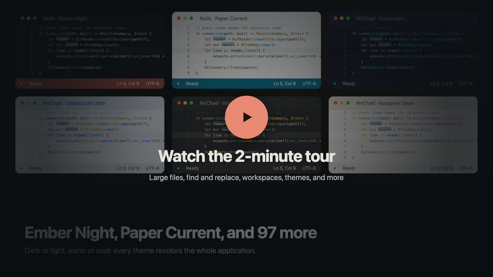
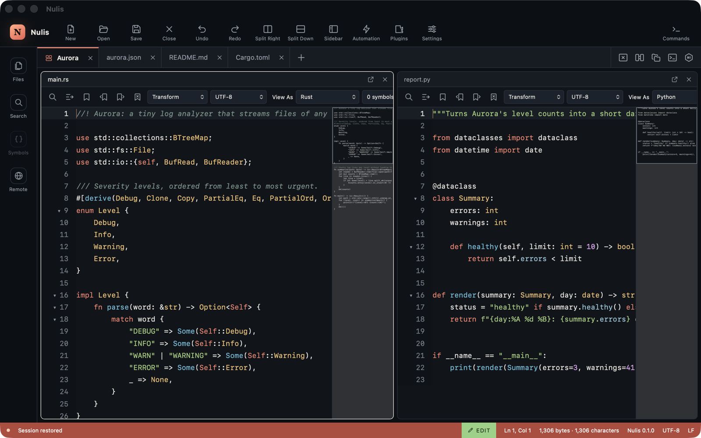
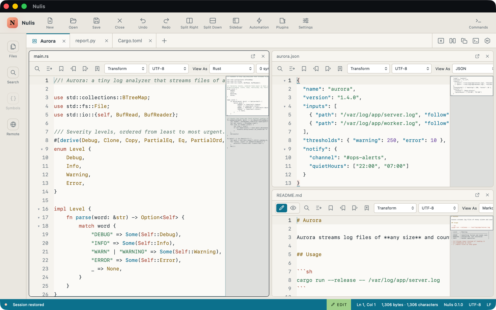
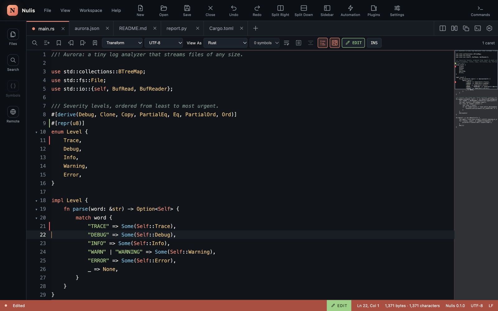
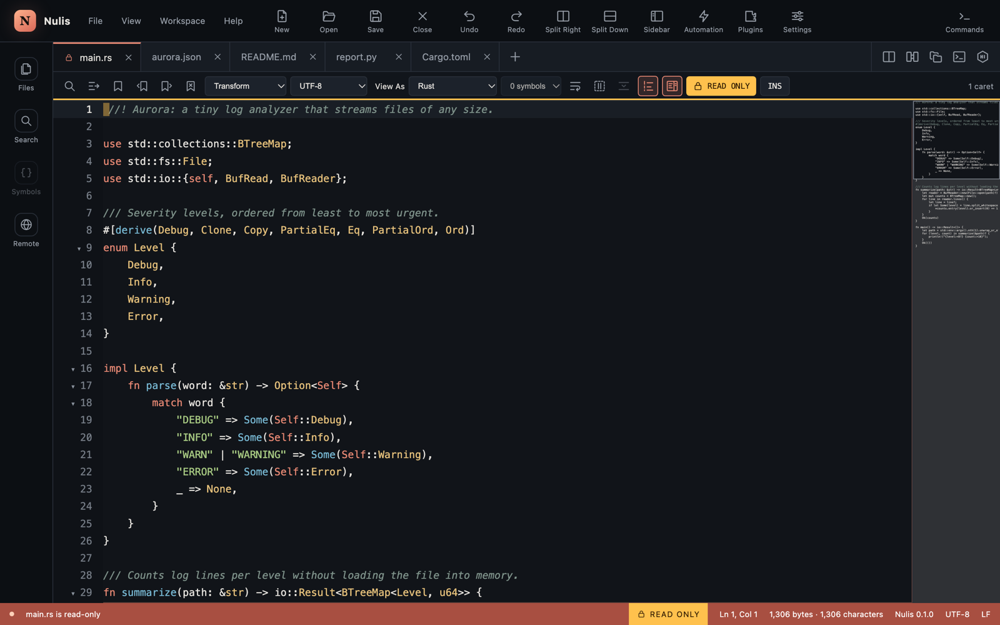
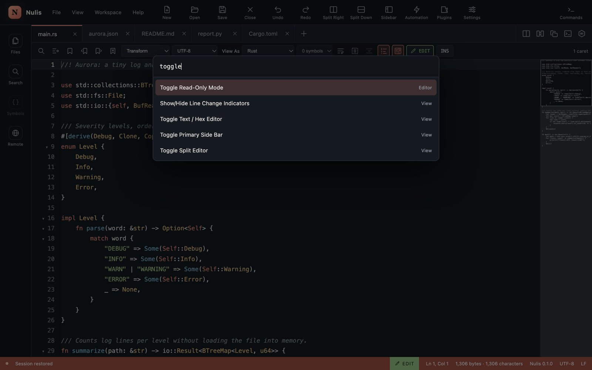
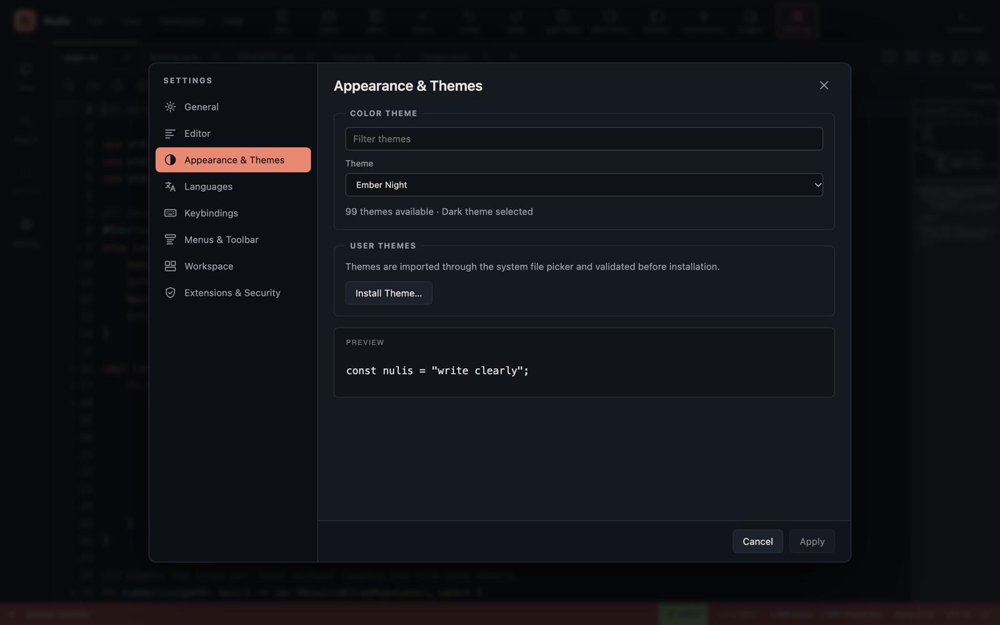
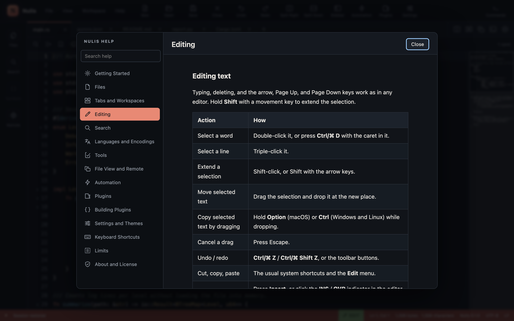
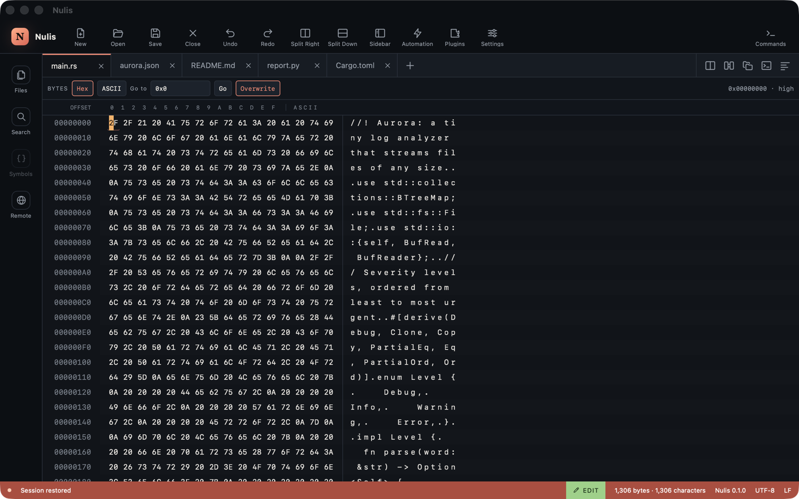

<p align="center"></p>

# Nulis

[](https://github.com/suhermanme/nulis/actions/workflows/ci.yml)

Nulis is a desktop editor for text, source code, hexadecimal data, and files larger than memory. It runs on macOS, Windows, and Linux.

*Nulis* is a Javanese word that means "writing" or "to write". The logo draws that idea as the letter N, whose last stroke is the text caret where writing happens.

Nulis is free software under the [GNU General Public License, version 3 or later](LICENSE).

**[Download the latest release](https://github.com/suhermanme/nulis/releases/latest)** for macOS, Windows, and Linux.

[](docs/media/nulis-tour.mp4)

**[▶ Watch the 2-minute tour](docs/media/nulis-tour.mp4)** (silent, with captions)



- [Installing](#installing)
- [A quick tour](#a-quick-tour)
- [What Nulis does](#what-nulis-does)
- [Project status](#project-status)
- [Using Nulis](#using-nulis)
- [Architecture](#architecture)
- [Repository layout](#repository-layout)
- [Building from source](#building-from-source)
- [Testing and quality checks](#testing-and-quality-checks)
- [Where Nulis stores data](#where-nulis-stores-data)
- [Extending Nulis](#extending-nulis)
- [Security model](#security-model)
- [Documentation](#documentation)
- [Contributing](#contributing)
- [License](#license)

## Installing

Download the file for your system from the [latest release](https://github.com/suhermanme/nulis/releases/latest).

### macOS

**With [Homebrew](https://brew.sh):**

```sh
brew tap suhermanme/nulis https://github.com/suhermanme/nulis
brew install --cask nulis
```

`brew upgrade --cask nulis` installs new releases, and `brew uninstall --cask nulis` removes Nulis (add `--zap` to also delete its settings and data). The first time you open Nulis, macOS blocks it; allow it once as described below.

**Or by hand:**

1. Download `Nulis_<version>_universal.dmg`. It runs on both Apple silicon and Intel Macs.
2. Open the `.dmg` and drag **Nulis** into **Applications**.
3. Open Nulis from Applications.

**The first time, macOS blocks it.** You will see a message such as *"Nulis" Not Opened — Apple could not verify "Nulis" is free of malware*. This is expected: Nulis is not notarized by Apple, which requires a paid Apple Developer membership. The app is signed so that macOS can tell it has not been altered, and you can allow it once:

1. In the message, click **Done** (do not choose Move to Trash).
2. Open **System Settings ▸ Privacy & Security**.
3. Scroll down to **Security**. Next to *"Nulis" was blocked to protect your Mac*, click **Open Anyway**.
4. Click **Open Anyway** again in the confirmation and enter your password or use Touch ID.

Nulis opens, and from then on it opens normally like any other app. You only do this once per installed version.

- The **Open Anyway** button appears only after you have tried to open Nulis, and it stays for about an hour. If you do not see it, open Nulis from Applications again and go back to Privacy & Security.
- On recent macOS versions, right-clicking the app and choosing **Open** no longer offers a way past this message; use **Open Anyway** in System Settings.

### Windows

Download `Nulis_<version>_x64-setup.exe` and run it. It installs for your user account without administrator rights. If Windows SmartScreen shows *Windows protected your PC*, click **More info**, then **Run anyway**: the installer is not signed with a paid code-signing certificate.

### Linux

Download the package for your distribution and install it with your package manager, which also installs the libraries Nulis needs:

```sh
# Debian, Ubuntu, and derivatives
sudo apt install ./Nulis_<version>_amd64.deb

# Fedora, RHEL, openSUSE, and derivatives
sudo dnf install ./Nulis-<version>-1.x86_64.rpm
```

Each release also has a `SHA256SUMS.txt` to check the downloads: `sha256sum -c SHA256SUMS.txt --ignore-missing` on Linux, or `shasum -a 256 -c SHA256SUMS.txt --ignore-missing` on macOS.

## A quick tour

**Workspaces of split panes, in any of 99 themes.** Drag a tab into the editor to view files side by side; here, Nulis · Paper Current with Rust, JSON, and Markdown.



**See what changed.** A red bar marks lines you have not saved yet; a green bar marks lines saved during this session. The tab shows a dot while the file has unsaved changes.



**Read-Only mode.** One click on the EDIT badge, or Ctrl/⌘ Shift L, protects a document from accidental edits. The badge turns amber, the tab shows a lock, and the caret becomes a steady block.



**Every command one search away.** Ctrl/⌘ K opens the command palette.



**Make it yours.** Settings has sections for the editor, themes, languages, keybindings, menus and toolbar, workspaces, and extensions.



**Help that is built in.** F1 opens the user guide and the plugin developer guide, with a section per chapter and a search field.



**Bytes, too.** The hexadecimal editor works on files of any size, with synchronized hex and text columns.



## What Nulis does

### Editing

- **Files of any size.** A file is never loaded whole. Nulis reads only what is on screen, so a 10 GiB file opens as fast as a small one, and editing in the middle of it is as fast as at the end.
- **Safe saving.** Save writes a temporary file beside the original, syncs it, verifies it, checks that nobody else changed the original, and replaces the original in one step. A failed save leaves the original untouched.
- **Undo and redo** within a memory budget. Undoing back to the saved content clears the unsaved mark.
- **Multiple carets** (Alt-click) and **column (block) editing** (Alt-Shift-drag or column mode), including typing and pasting across rows.
- **Precise pointer editing**: double-click selects a word, triple-click a line, and a selection can be dragged to move or copy it as one undo step.
- **Insert and overwrite modes**, case and whitespace transforms, word wrap, bookmarks, and code folding.
- **Edit and Read-Only modes** per document, switched with one click or Ctrl/⌘ Shift L and shown unmistakably in the status bar, toolbar, and tab. Read-only is enforced in the core, so nothing can change a protected document.
- **A status bar** with the mode, the caret's line and column, and the document's size in bytes and in characters.
- **Line change indicators** in the gutter: red for unsaved changes, green for changes saved in this session, a notch where lines were deleted.
- **Encodings**: UTF-8 and Windows-1252, switchable per document without rewriting bytes that were not edited.
- **Crash recovery**: unsaved edits of local and untitled documents are checkpointed and offered for recovery at the next start.

### Finding things

- **Find and replace** in the current file, with match case, whole words, regular expressions that can never hang (even on huge files), capture groups in the replacement (`$1`, `${name}`), search within columns, multi-line matches, and Replace All as one undo step.
- **Find in files** across a folder, with fixed limits on files and results.
- **Go to line**, a **symbols list** per document, bracket matching, and a document map.

### Languages

- **Syntax highlighting, folding, and symbols** for 40 languages: AppleScript, Bash, Batch, C, C++, C#, CSS, CSV, Dockerfile, Go, HTML, INI, Java, JavaScript, JSON, Kotlin, Lua, Makefile, Markdown, MySQL / MariaDB, Objective-C / Objective-C++, Oracle PL/SQL, Perl, PHP, PowerShell, Property List, Python, Ruby, Rust, SQL, Swift, TOML, TSV, TypeScript, VBScript / ASP, Visual Basic, XML, XSL, YAML, and Zig. A sample of each is in [`Samples/`](Samples).
- **Detection** from the file name and extension, and from the content (`#!` line, XML declaration, `<?php`, HTML doctype) when the name says nothing. A **View As** control overrides it.

### Tools

- **JSON, XML, YAML, and plist tools**: validate (the caret moves to the first problem, and repeated keys are caught), beautify, and JSON minify. YAML Beautify asks before it would drop comments. The tools are offered only while such a document is focused.
- **Hexadecimal editor** with synchronized hex and text columns, for files of any size.
- **Compare and merge** two documents (text by line, binary by byte) and **compare folders**.
- **Markdown preview** with GitHub-style syntax and local images.
- **Integrated terminal** running the platform's default shell.
- **Remote files** over SFTP, read-only, with pinned host keys and passwords kept in the operating system's keychain.

### Workbench

- **Tabs and workspaces.** Drag a tab into the editor area to group files into one named workspace tab with split panes. Panes can be resized, rearranged, popped back out, and are restored with the session.
- **File View** with three tabs: open files, the whole computer (home, common folders, mounted volumes), and the opened folder.
- **Command palette** for every command, icon toolbars with captions and tooltips, and native menus.
- **Sessions**: open files, layout, folder, and side bar are restored at startup.
- **Opening from the system**: on macOS, Nulis appears in Finder's **Open With** menu for text, code, and data files (without becoming the default app), and accepts files dropped on its Dock icon. Files arrive in the running window.

### Customization and extension

- **Settings window** with sections for the editor, appearance, languages, keybindings, menus and toolbar, workspaces, and extensions.
- **99 built-in color themes**, with Nulis's own Ember Night and Paper Current first, plus user-installed themes. In every theme the selection, secondary text, and toolbar icons are kept clearly visible.
- **Configurable** shortcuts, File menu, and main toolbar.
- **Macros** (record and replay) and **scripts** that run only after explicit approval of the commands they use.
- **Plugins** written in JavaScript, each running in an isolated worker process and approved by content digest.

## Project status

Nulis is at version 0.1.0 and under active development. The features above are implemented and covered by automated tests. What remains before a first release:

- It is developed and built on macOS. Windows and Linux builds are defined in CI but have not yet been validated on hosted runners or by hand.
- Installers are not signed or notarized.
- Encoding support is limited to UTF-8 and Windows-1252, without automatic detection.
- Remote (SFTP) files are read-only.
- XML validation checks well-formedness only, not DTDs or schemas.
- Manual accessibility testing with screen readers is pending.

[docs/FEATURE_PARITY.md](docs/FEATURE_PARITY.md) tracks each capability in detail, and [docs/ROADMAP.md](docs/ROADMAP.md) lists what is planned.

## Using Nulis

The complete user guide is [docs/USER_GUIDE.md](docs/USER_GUIDE.md). The same guide is built into the application under **Help ▸ Nulis Help** (F1), which opens a separate Help window with one section per chapter and a search field. **Help ▸ About Nulis** shows the version, the origin of the name, and the license.

The essentials:

| Action | Shortcut |
| --- | --- |
| New / Open / Save / Save As | Ctrl/⌘ N / O / S / Shift S |
| Close file | Ctrl/⌘ W |
| Command palette | Ctrl/⌘ K |
| Edit / Read-Only mode | Ctrl/⌘ Shift L |
| Settings | Ctrl/⌘ , |
| Find / Replace / Go to line | Ctrl/⌘ F / H / G |
| Undo / Redo | Ctrl/⌘ Z / Shift Z |
| Select word | Ctrl/⌘ D or double-click |
| Add a caret | Alt + click |
| Select a rectangle | Alt + Shift + drag |
| Toggle / next / previous bookmark | Ctrl/⌘ F2 / F2 / Shift F2 |
| Help | F1 |

Ctrl/⌘ means Control on Windows and Linux and Command on macOS.

## Architecture

Nulis is a Rust core with a thin desktop shell. The core has no dependency on the user interface and can be driven headlessly; the interface is a React application inside a [Tauri 2](https://tauri.app) webview.

```text
┌──────────────────────────────────────────────────────────────┐
│ React + TypeScript presentation   (apps/desktop/src)         │
│ virtualized viewport · tabs and workspaces · panels · menus  │
└───────────────────────────────┬──────────────────────────────┘
                                │ versioned, typed IPC messages
┌───────────────────────────────┴──────────────────────────────┐
│ Tauri adapter   (apps/desktop/src-tauri)                     │
│ validates input · per-window command allowlist · native menu │
└───────────────────────────────┬──────────────────────────────┘
                                │ commands by stable string ID
┌───────────────────────────────┴──────────────────────────────┐
│ nulis-core: command registry and document sessions           │
└──────┬───────────────────┬───────────────────────┬───────────┘
       │                   │                       │
   documents            services               extensions
 nulis-document      nulis-search            nulis-automation
 nulis-large-file    nulis-syntax            nulis-plugin-host
                     nulis-hex               nulis-theme
                     nulis-diff              nulis-settings
                     nulis-filesystem
                     nulis-remote
                     nulis-terminal
                     nulis-platform
```

### Principles

1. **The document is never one string.** The interface receives only bounded viewport snapshots: the lines on screen, with byte offsets. No operation's cost or memory depends on the size of the file unless it has to (a full search, a save).
2. **Everything is a command.** Menus, toolbars, shortcuts, the palette, macros, and plugins all run the same commands, identified by stable strings such as `file.save` or `tools.beautify`.
3. **Positions are 64-bit byte offsets.** Text decoding is a layer above byte storage, so invalid bytes, an encoding override, and the hexadecimal view never lose data.
4. **Every edit carries the revision it was based on.** A request made against a stale view of the document is refused instead of being applied at the wrong place.
5. **Every operation is bounded.** Results, listings, regular-expression matches, undo history, plugin resources, and layouts all have explicit limits, and the interface says when one is reached.
6. **Private types never cross a boundary.** The interface and plugins see only serializable messages and opaque document handles.

### The large-file engine

A document is a **piece table**: an immutable, randomly accessible original file plus an append-only buffer of added bytes, both on disk. A balanced tree (an implicit treap) maps positions in the document to ranges in one of the two. An edit appends its new bytes and replaces the tree root; the original file is not touched until a save.

- **Line numbers** come from sparse checkpoints built by a cancellable background pass, so going to a line in a huge file does not scan from the start.
- **Undo** records the inverse of each edit under a byte budget.
- **Recovery** stores the list of ranges, not the bytes: an append-store sync followed by an atomic manifest write. At restart the original file's fingerprint is checked before the document is rebuilt.
- **Save** streams the pieces to a temporary file in the same directory, syncs and validates it, re-checks the destination, and replaces it atomically.

### Crates

| Crate | Responsibility |
| --- | --- |
| `nulis-core` | Command registry, document sessions, editing operations, line change tracking, JSON, XML, YAML, and plist tools, and orchestration of every other crate. |
| `nulis-document` | Piece table, 64-bit positions, snapshots, and undo history. |
| `nulis-large-file` | Random-access byte sources and append stores. |
| `nulis-search` | Streaming find and replace, linear-time regular expressions with capture-group replacement, column search, and find in files. |
| `nulis-syntax` | Language detection, Tree-sitter parsers for JSON and Python, a table-driven lexer for the other languages, folding, and symbols. |
| `nulis-hex` | Hexadecimal viewports and byte editing. |
| `nulis-diff` | Text, binary, and folder comparison. |
| `nulis-filesystem` | Folders, the Places tree, and session persistence. |
| `nulis-remote` | SFTP profiles, host key pinning, and remote reads. |
| `nulis-terminal` | Pseudoterminal sessions. |
| `nulis-platform` | Operating-system specifics. |
| `nulis-settings` | Layered settings and customization storage. |
| `nulis-theme` | Theme tokens, built-in themes, user theme validation, and contrast floors applied to every theme. |
| `nulis-automation` | Macros and the restricted script evaluator. |
| `nulis-plugin-host` | Plugin packages, approval, and isolated workers. |
| `nulis-desktop` (`apps/desktop/src-tauri`) | The Tauri adapter: windows, native menus, and IPC. |
| `nulis-benchmarks` | Performance probes. |

Every crate in the workspace forbids `unsafe` code.

### The desktop application

`apps/desktop/src` is a React 18 and TypeScript application. `contracts.ts` mirrors the Rust message types, and the application checks the IPC protocol version at startup and refuses to run against a mismatched core. Settings open in a second window that is allowed to call only the commands it needs.

[docs/ARCHITECTURE.md](docs/ARCHITECTURE.md) describes each boundary in detail, and [docs/DECISIONS.md](docs/DECISIONS.md) records why things are the way they are.

## Repository layout

```text
apps/desktop/            The desktop application
  src/                   React and TypeScript interface, with its tests
  src-tauri/             Tauri adapter (Rust), icons, and bundle configuration
crates/                  The Rust core and its services (see the table above)
packages/
  nulis-plugin-sdk/      TypeScript SDK for plugin authors
examples/plugins/        Two sample plugins
themes/                  Built-in themes and the converted theme catalog
benchmarks/              Performance probes
fuzz/                    Fuzz target for the document model
tests/                   Cross-crate integration tests
Casks/nulis.rb           Homebrew cask for macOS
docs/                    Design, specification, and user documentation
LICENSE                  GNU General Public License, version 3
THIRD_PARTY_LICENSES.md  Licenses of dependencies
```

## Building from source

### Prerequisites

| Tool | Version |
| --- | --- |
| [Rust](https://rustup.rs) | 1.82 or later, with `rustfmt` and `clippy` |
| [Node.js](https://nodejs.org) | 20 or later |
| npm | 10 or later |

A C compiler, `perl`, and `make` are also needed on macOS and Linux, because OpenSSL is compiled into the application; they come with the Xcode Command Line Tools and with `build-essential`. Windows uses the system's own cryptography and needs neither.

Each platform also needs what Tauri 2 needs:

- **macOS**: the Xcode Command Line Tools (`xcode-select --install`).
- **Windows**: the Microsoft C++ Build Tools and the WebView2 runtime (included in Windows 11).
- **Linux** (Debian or Ubuntu):

  ```sh
  sudo apt-get install -y libwebkit2gtk-4.1-dev libappindicator3-dev librsvg2-dev patchelf
  ```

The Tauri [prerequisites page](https://tauri.app/start/prerequisites/) covers other distributions.

### Get the dependencies

```sh
git clone <repository-url> nulis
cd nulis
npm ci
```

Rust dependencies are fetched on the first build.

### Run in development

```sh
npm run dev
```

This starts the Vite development server and opens the application with live reload. Rust changes rebuild and restart it.

### Build a release

```sh
npm run build
```

This type-checks and bundles the interface, compiles the Rust code in release mode, and produces an application and installer for the current platform under `target/release/bundle/`:

| Platform | Output |
| --- | --- |
| macOS | `macos/Nulis.app` and `dmg/Nulis_<version>_<arch>.dmg`, ad-hoc signed |
| Windows | An NSIS installer under `nsis/` and an MSI under `msi/` |
| Linux | `.deb`, `.rpm`, and AppImage packages |

To build only one kind of bundle, pass it to Tauri:

```sh
npm run build --workspace @nulis/desktop -- --bundles app
```

Builds are not signed. [docs/RELEASE.md](docs/RELEASE.md) describes the release process.

### What a shipped build depends on

Users install nothing besides Nulis. The core, the interface, the themes, the help, and OpenSSL are all inside the executable. The only outside component is the operating system's web engine:

| Platform | Web engine | For the user |
| --- | --- | --- |
| macOS | WebKit, part of macOS | Nothing to install. |
| Windows 11 | WebView2, preinstalled | Nothing to install. |
| Windows 10 | WebView2 | The installer downloads it if it is missing. |
| Linux `.deb` / `.rpm` | WebKitGTK 4.1 | Installed automatically as a package dependency. |
| Linux AppImage | Bundled | Nothing to install. |

On macOS you can confirm that a build links only to system libraries with `otool -L target/release/nulis-desktop`.

### Signing

macOS builds are ad-hoc signed, which lets users allow a downloaded copy with **Open Anyway** (see [Installing](#macos)); without a signature macOS reports the app as damaged and offers no way to open it. Builds signed with an Apple Developer ID and notarized, and Windows builds signed with a code-signing certificate, avoid the first-launch prompts; see [docs/RELEASE.md](docs/RELEASE.md).

### Build parts separately

```sh
npm run frontend:build --workspace @nulis/desktop   # interface only, into apps/desktop/dist
cargo build --workspace --locked                    # all Rust crates
cargo build --release -p nulis-benchmarks           # the performance probe
```

## Testing and quality checks

These are the checks CI runs on every push to `main` and every pull request ([`.github/workflows/ci.yml`](.github/workflows/ci.yml)). All must pass before a change is merged. CI also builds an installable bundle on macOS, Windows, and Linux, runs the document fuzzer for a minute, runs a large-file smoke benchmark, and checks dependencies for known advisories.

```sh
# Rust
cargo fmt --all --check
cargo clippy --workspace --all-targets --locked -- -D warnings
cargo test --workspace --locked

# Interface
npm run lint
npm run typecheck
npm run test
```

- Rust unit tests live beside the code they test. They include files larger than 4 GiB, made as sparse files so they take no real disk space.
- Interface tests use Vitest and Testing Library against a mocked core.
- The document model has a fuzz target; see [fuzz/README.md](fuzz/README.md).
- Performance methodology and the baseline measurements are in [docs/PERFORMANCE.md](docs/PERFORMANCE.md) and [benchmarks/README.md](benchmarks/README.md).

Clippy runs with the pedantic lints as errors.

## Where Nulis stores data

Nulis keeps its data in the operating system's application-data directory for the identifier `com.nulis.editor`:

| Platform | Location |
| --- | --- |
| macOS | `~/Library/Application Support/com.nulis.editor/` |
| Windows | `%APPDATA%\com.nulis.editor\` |
| Linux | `~/.local/share/com.nulis.editor/` |

It holds the session (open files and layout), customization (appearance, shortcuts, menu, toolbar), installed themes and plugins, recovery checkpoints, and the edit buffers of open documents. Passwords for remote profiles are stored in the operating system's keychain, not in these files. A few display preferences are kept in the webview's local storage.

## Extending Nulis

- **Themes** are declarative JSON files. [docs/THEME_SPEC.md](docs/THEME_SPEC.md) lists every token. Install one from **Settings ▸ Appearance & Themes**.
- **Plugins** are JavaScript packages with a manifest. [docs/PLUGIN_GUIDE.md](docs/PLUGIN_GUIDE.md) is the step-by-step developer guide (also shown in Help as *Building Plugins*), [docs/PLUGIN_API.md](docs/PLUGIN_API.md) is the short contract, and `packages/nulis-plugin-sdk` provides the TypeScript types. Two working examples are tested against the real plugin worker: `examples/plugins/hello-nulis` (one command, plain JavaScript) and `examples/plugins/nulis-tips` (TypeScript, two commands, startup activation, arguments, results, and a build step).
- **Macros and scripts** are created in the application under **Automation**.
- **Languages** handled by the table-driven lexer are described by data in `crates/nulis-syntax/src/lexer.rs`: keywords, comment and string syntax, and file names. Adding a language is adding a table entry and a test.

## Security model

- The webview runs under a strict content security policy: no remote scripts, no inline scripts, no frames.
- The interface can reach the system only through the adapter's commands, which validate every argument. The Settings window has its own, smaller allowlist.
- Plugins and scripts are denied by default. Each must be approved, approval is bound to the exact content, and a plugin runs in a separate process with resource limits.
- Remote connections require a pinned SHA-256 host key.
- Markdown preview does not render raw HTML.
- Folder operations do not follow symbolic links out of the opened folder.

[docs/SECURITY.md](docs/SECURITY.md) has the threat model.

## Documentation

| Document | Contents |
| --- | --- |
| [docs/USER_GUIDE.md](docs/USER_GUIDE.md) | How to use the application. Also shown under Help. |
| [docs/ARCHITECTURE.md](docs/ARCHITECTURE.md) | Component boundaries and the large-file engine. |
| [docs/DECISIONS.md](docs/DECISIONS.md) | Design decisions and their reasons. |
| [docs/PRODUCT_SPEC.md](docs/PRODUCT_SPEC.md) | What the product is meant to be. |
| [docs/IMPROVEMENT_SPEC.md](docs/IMPROVEMENT_SPEC.md) | Specification of the interaction and layout milestones. |
| [docs/FEATURE_PARITY.md](docs/FEATURE_PARITY.md) | Status of every capability. |
| [docs/ROADMAP.md](docs/ROADMAP.md) | Milestones. |
| [docs/WORK_STATE.md](docs/WORK_STATE.md) | What was done most recently and what is next. |
| [docs/PLUGIN_GUIDE.md](docs/PLUGIN_GUIDE.md) | How to build a plugin, step by step. Also shown under Help. |
| [docs/PLUGIN_API.md](docs/PLUGIN_API.md) | The plugin API contract. |
| [docs/THEME_SPEC.md](docs/THEME_SPEC.md) | Theme file format. |
| [docs/SECURITY.md](docs/SECURITY.md) | Threat model and security rules. |
| [docs/PERFORMANCE.md](docs/PERFORMANCE.md) | Performance invariants and measurements. |
| [docs/RELEASE.md](docs/RELEASE.md) | Release process. |
| [docs/CLEAN_ROOM.md](docs/CLEAN_ROOM.md) | Rules for keeping the implementation original. |

## Contributing

- Run the checks under [Testing and quality checks](#testing-and-quality-checks) before sending a change.
- New behavior needs a test. A bug fix needs a test that fails without the fix.
- Keep operations bounded: a new feature must not read, hold, or send a whole document unless its purpose requires it, and then it needs a size limit.
- Record a new dependency and its license in [THIRD_PARTY_LICENSES.md](THIRD_PARTY_LICENSES.md). It must be compatible with GPL version 3.
- Nulis is an original implementation. It takes ideas about what an editor should do from existing editors but contains no code or assets from them. [docs/CLEAN_ROOM.md](docs/CLEAN_ROOM.md) has the rules.

## License

Copyright © 2026 Muhammad Edy Suherman.

Nulis is free software; you can redistribute it and/or modify it under the terms of the GNU General Public License as published by the Free Software Foundation, either version 3 of the License, or (at your option) any later version.

Nulis is distributed in the hope that it will be useful, but WITHOUT ANY WARRANTY; without even the implied warranty of MERCHANTABILITY or FITNESS FOR A PARTICULAR PURPOSE. See the GNU General Public License for more details.

You should have received a copy of the GNU General Public License along with Nulis. If not, see <https://www.gnu.org/licenses/>.

The full text is in [LICENSE](LICENSE) and is shown in the application under **Help ▸ About Nulis ▸ View License**.

Licenses of the libraries Nulis depends on are listed in [THIRD_PARTY_LICENSES.md](THIRD_PARTY_LICENSES.md). The bundled NvChad Base46 themes keep their own license notices under `themes/nvchad-source`.
